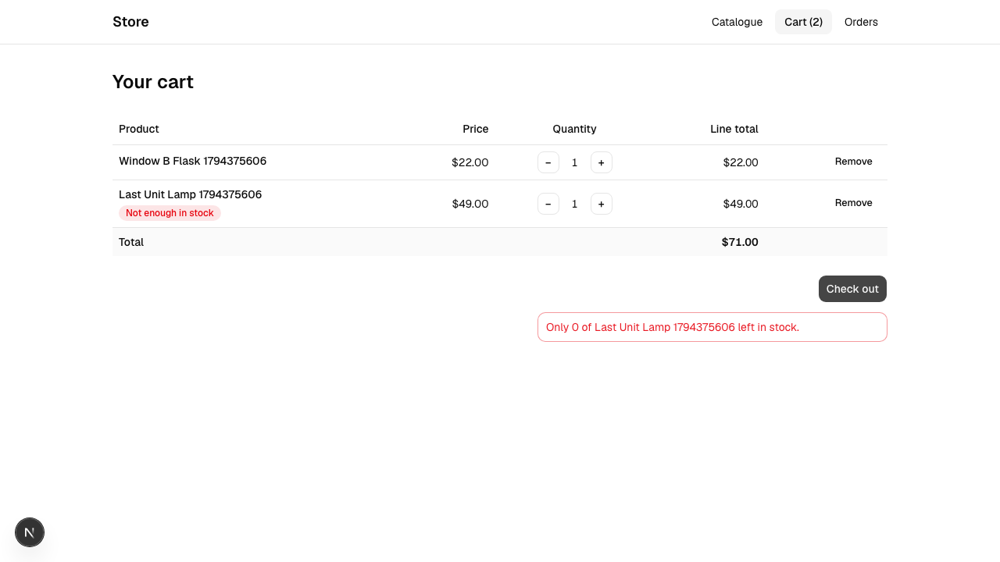
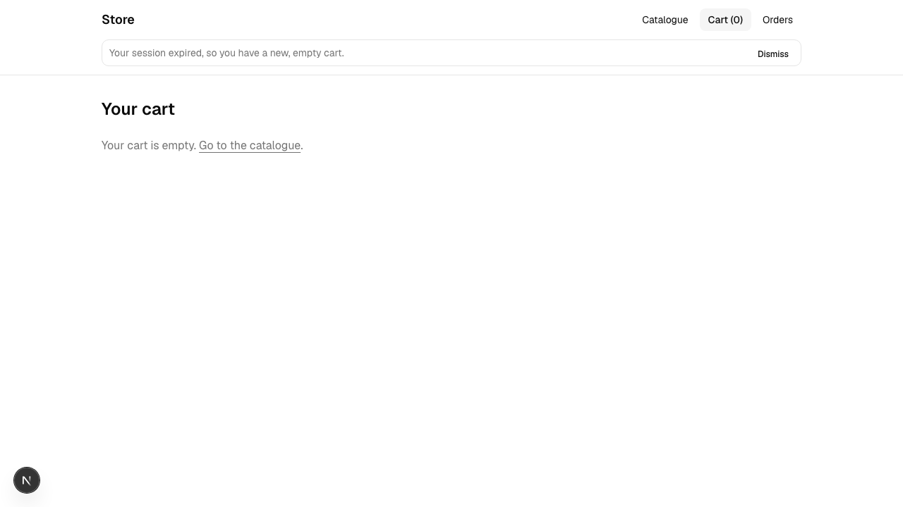

# Step M6-4 · The walkthrough

**Why:** `pnpm build` proves the code compiles. It doesn't prove the store works for two customers at once, or that a price change leaves old orders alone, or that an expired session doesn't strand anyone. Those were the promises of M3 to M5, and your spec repeats them as the walkthrough. Now you check each one with your own eyes, the way a customer would meet it.

## Start everything

Your store, as always:

```
make up
```

In a second terminal, in your repository, the frontend:

```
cd frontend
pnpm dev
```

It prints `Local: http://localhost:3000` when it's ready. Open that address in a **normal window**, and again in a **private window** of the same browser (⌘⇧N in Chrome). Each has its own storage, so each is its own customer. Two private windows wouldn't be: in Chrome, all private windows share one store.

## 1. Two windows, two carts

**Predict,** under `## M6-4` in `PREDICTIONS.md`, for each of the four checks before you do it: what will each window show?

In the normal window, add one product to the cart. In the private window, add a different one. Open the cart in each.

**Expected:** each cart holds only its own product.

## 2. The last unit

A product with exactly one in stock. Note its `id` in the answer:

```
./store products create --sku LAST-1 --name 'Last Lantern' --category lighting --price-cents 4900 --stock 1
```

Reload the catalogue in both windows, and add the Last Lantern to both carts. Open both carts. Click **Check out** in one window, then in the other, as quickly as you can.

**Expected:** one window goes to its order. The other stays on its cart, showing your API's message in your spec's style: "Only 0 of Last Lantern left in stock." Its cart is unchanged. Mine, in the window that lost:



## 3. A price change

In the terminal, change the lantern's price, with the `id` you noted:

```
./store products update <id> --price-cents 5900
```

Reload the catalogue. **Expected:** $59.00. Now open Orders in the window that bought the lantern. **Expected:** that order still says $49.00, the price that was paid. You decided that in M4, with the price in each order line.

## 4. An expired session

Expire every session, as an hour's wait would:

```
docker compose exec db psql -U store -d store -c "UPDATE sessions SET expires_at = now() - interval '1 minute';"
```

Reload the cart in either window. **Expected:** no error page. An empty cart, and your spec's notice. Then add something to the cart: it works. Mine:



<details><summary>What happened when this was tested</summary>

The frontend built from the course's own spec was walked through on 2026-11-11 in a headless browser, with two separate browser profiles standing in for the normal and the private window. All four checks showed what the spec says:
1. **Two windows, two carts:** each cart held only its own product.
2. **The last unit:** the two checkouts were clicked at the same moment. One window went to "Order #… placed." The other stayed on its cart, with "Only 0 of … left in stock." in a red alert, and the line marked "Not enough in stock". The stock ended at 0.
3. **A price change:** the catalogue showed the new $59.00, and the order still showed $49.00.
4. **An expired session:** the cart page showed an empty cart, and the notice in a bar under the header. Adding to the cart worked straight away, on a new session.

The agent had also tested its own code before it finished. It couldn't open a browser, so it ran its API code in Node, against the store, through the same four checks, and they passed.
</details>

## Read the code

Your agent wrote it, and you're responsible for it. Find where the frontend keeps the token, and where it sends it. In the build tested here, both were in one file, `frontend/src/lib/api.ts`. Find the code that handles a `401`. Then make **one change to the agent's code yourself,** by hand: something you'd do differently, or a gap your walkthrough found. If your spec didn't say what `−` does at a quantity of 1, that's a good one. Check that `pnpm lint` and `pnpm build` still pass.

Write under `## M6 walkthrough` in `JOURNAL.md`:
- what each of the four checks showed;
- where the token is stored, and where it's sent, with the file and line;
- the change you made, and why.

## Check

```
make check M=6 STEP=4
```

**You should see** everything before, then:

```
Saved to checks/last-run.txt
```

## Step done

```
git add -A
git commit -m "M6-4: the walkthrough"
git push
```

Answer your tutor's questions under `## M6-4` in `JOURNAL.md`.
